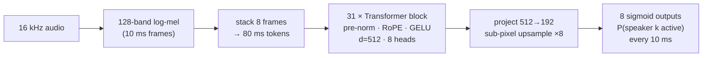
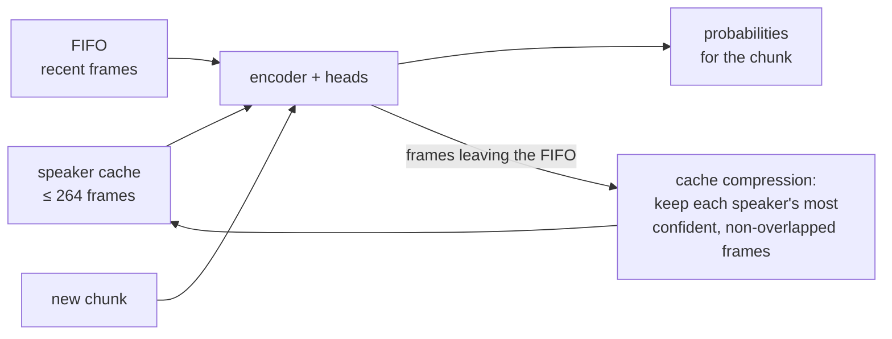

<div align="center">

# nemotron-diar-mlx

**Who spoke when — on your Mac.**

NVIDIA's [Nemotron 3 Diarization](https://huggingface.co/nvidia/Nemotron-3-Diarization) running natively on Apple
Silicon with [MLX](https://github.com/ml-explore/mlx). Up to 8 speakers, streaming or offline, recordings of any length.
No PyTorch, no CUDA, no cloud.

[](https://github.com/9clg6/nemotron-diar-mlx/actions/workflows/ci.yml)
[](https://github.com/9clg6/nemotron-diar-mlx/actions/workflows/benchmark.yml)
[](LICENSE)
[](pyproject.toml)
[](https://huggingface.co/nvidia/Nemotron-3-Diarization)

</div>

```console
$ python -m nemotron_diar_mlx meeting.wav
0.35 9.31 speaker_0
9.15 13.81 speaker_1
13.55 18.32 speaker_2
18.38 23.59 speaker_3
23.77 28.10 speaker_4
27.80 32.69 speaker_5
...
```

<details>
<summary><b>…and, with any ASR that gives word timestamps, who said what</b></summary>

```text
[ 0.2s] speaker 0: To celebrate the release of Nemotron 3 Diarization, we invited seven more open text-to-speech
                    voices to the party. I'm Chris, the Nemotron voice from NVIDIA.
[ 9.4s] speaker 1: Hi, everybody. Thanks for having me. I'm Jane, a pocket voice from QTI.
[13.8s] speaker 2: Nice to meet you, Chris and Jen. I'm Serena, the Quinn3 Voice.
[18.4s] speaker 3: Hey, I'm Adam from Kokoro. Just 82 million parameters, and I still made the guest list.
[23.7s] speaker 4: Hello, hello. Chatterbox here from Resemble AI. I brought the expressive energy.
[28.1s] speaker 5: Hi, I'm John, a Dio Voice from Nari Labs. Great crowd, we've got here already.
```

Real output on NVIDIA's [8-voice demo clip](https://huggingface.co/datasets/hf-internal-testing/dummy-audio-samples),
transcribed with [parakeet-mlx](https://github.com/senstella/parakeet-mlx). See [Who said what](#who-said-what).
</details>

## Highlights

- **Faithful.** A line-by-line port of NeMo's inference (features, encoder, Sortformer heads, streaming speaker cache,
  post-processing), checked against NeMo on the real checkpoint: identical segments, probabilities within 1e-5
  ([details](#accuracy)).
- **Fast.** 10 minutes of meeting audio diarized in 5 seconds on a base M1, in half a gigabyte of memory
  ([benchmark](#performance)).
- **Streaming first.** Constant memory and stable speaker IDs over hours of audio, with NVIDIA's latency presets from
  0.32 s to 30 s. Feed audio in blocks of any size.
- **Zero-friction weights.** Pulls the official weights from Hugging Face and converts them once, in pure MLX/NumPy.
- **Who said what.** Attribute every word of any timestamped transcript to its speaker in one call.
- **Small and hackable.** About 1,700 lines of documented Python on top of `mlx`, `numpy` and `huggingface_hub`.

## Contents

[Install](#install) · [Quick start](#quick-start) · [Who said what](#who-said-what) · [Streaming](#streaming) ·
[How it works](#how-it-works) · [Performance](#performance) · [Accuracy](#accuracy) · [API](#api) ·
[Weights](#weights-and-conversion) · [Limitations](#limitations) · [Development](#development) ·
[Credits](#credits-and-license)

## Install

```bash
pip install git+https://github.com/9clg6/nemotron-diar-mlx
```

macOS on Apple Silicon, Python 3.10–3.14. The model (~400 MB) is downloaded on first use. MLX also runs on Linux
(`pip install "mlx[cpu]"`), which is handy for tests but slow.

## Quick start

**Command line.** Input is 16 kHz audio (`ffmpeg -i input.m4a -ar 16000 -ac 1 meeting.wav`):

```bash
python -m nemotron_diar_mlx meeting.wav                 # start end speaker_N
python -m nemotron_diar_mlx meeting.wav --json          # {"num_speakers": 6, "segments": [...]}
python -m nemotron_diar_mlx meeting.wav --rttm          # for DER scoring tools
python -m nemotron_diar_mlx meeting.wav --preset low_latency --min-duration-off 0.3
```

**Python:**

```python
import mlx.core as mx
from nemotron_diar_mlx import Model

model = Model.from_pretrained("nvidia/Nemotron-3-Diarization", dtype=mx.bfloat16)

for seg in model.diarize(audio):          # mono float32 NumPy array at 16 kHz
    print(f"{seg.start:6.2f}–{seg.end:6.2f}  speaker_{seg.speaker}")

probs = model(audio)["preds"]             # (frames, 8): P(speaker active), one frame every 10 ms
```

Speakers are numbered in order of first appearance: `speaker_0` speaks first.

## Who said what

Diarization tells you *when* each person talks; an ASR tells you *what* was said. `words_to_turns` joins the two: each
word goes to the speaker most active during that word, and consecutive words of one speaker become a turn. It works
with any ASR that returns word or token timestamps. Here with [parakeet-mlx](https://github.com/senstella/parakeet-mlx),
which is MLX-native too:

```python
import mlx.core as mx
from parakeet_mlx import from_pretrained
from nemotron_diar_mlx import Model, tokens_to_words, words_to_turns

diar = Model.from_pretrained(dtype=mx.bfloat16)
probs = diar(audio)["preds"]

asr = from_pretrained("mlx-community/parakeet-tdt-0.6b-v3").transcribe("meeting.wav")
words = tokens_to_words(tok for sentence in asr.sentences for tok in sentence.tokens)

for turn in words_to_turns(words, probs, diar.frame_duration):
    print(f"[{turn.start:5.1f}s] speaker {turn.speaker}: {turn.text}")
```

With another ASR, build `Word(start, end, text)` objects yourself, keeping a leading space at word boundaries.

## Streaming

The model processes audio in chunks. Each chunk is encoded together with a compact **speaker cache** (the most
representative frames of every speaker heard so far) and a short FIFO of recent context. Memory stays constant,
speaker IDs stay consistent for hours, and you choose the latency:

| Preset | Latency¹ | Use it for |
|---|---|---|
| `offline` (default) | 30.4 s | recordings: best accuracy |
| `low_latency` | 1.04 s | live captions |
| `very_low_latency` | 0.64 s | live, tighter |
| `ultra_low_latency` | 0.32 s | real-time voice agents |

¹ Input buffer latency = (chunk + look-ahead) × 80 ms, as on the
[model card](https://huggingface.co/nvidia/Nemotron-3-Diarization); compute time not included. The exact parameters
are in `nemotron_diar_mlx.STREAMING_PRESETS`.

```python
import queue
import sounddevice as sd                       # pip install sounddevice
from nemotron_diar_mlx import Model, StreamingDiarizer

model = Model.from_pretrained(streaming="low_latency")
diar = StreamingDiarizer(model)
blocks = queue.Queue()

# Keep the audio callback light: just hand the samples over.
with sd.InputStream(samplerate=16000, channels=1, dtype="float32",
                    callback=lambda data, *_: blocks.put(data[:, 0].copy())):
    while True:
        out = diar.feed(blocks.get())          # any block size
        for i, frame in enumerate(out.preds):  # frames finalized since the last call, 10 ms each
            t = (out.start_frame + i) * diar.frame_duration
            speaking = [k for k, p in enumerate(frame) if p > 0.5]
            ...
```

Feeding a recording in pieces gives the same result as processing it at once (bit-identical on CPU; within ~1e-6 on
the GPU, whose kernels round slightly differently with the block size).

### Live server

Need diarization from another process or language? A small WebSocket server ships with the package:

```bash
pip install "nemotron-diar-mlx[server]"
python -m nemotron_diar_mlx.server --port 8001 --preset low_latency
```

`GET /health` answers 200 once the model is loaded and warmed up. Each connection to `ws://127.0.0.1:8001/v1/diarize`
is one session:

- send **binary** messages of raw PCM (16-bit little-endian, mono, 16 kHz, any block size), then the text message
  `{"type": "flush"}` at the end;
- receive `{"type": "ready", "frame_duration": 0.01, "num_speakers": 8, "latency": 1.04}` on connect,
  `{"type": "frames", "start_frame": n, "probs": [[...], ...]}` as frames are finalized (one row of per-speaker
  probabilities per 10 ms, counted from the first sample sent), and `{"type": "done", "num_frames": n}` after the flush.

The server queues audio while a chunk is computing and processes the backlog in one go, so a slow step delays the
labels but never drops audio. `--parent-pid` makes it exit together with the app that launched it.

## How it works



In streaming, each step encodes `[speaker cache | FIFO | new chunk]` with full attention, then updates the state:



The cache is ordered by each speaker's first arrival (the *Arrival-Order Speaker Cache* of
[Streaming Sortformer](https://arxiv.org/abs/2507.18446)), so output channel *k* always means the *k*-th person to
speak: no clustering, no permutation step.

| File | Contents |
|---|---|
| [`model.py`](nemotron_diar_mlx/model.py) | encoder, Sortformer heads, loading, offline inference |
| [`streaming.py`](nemotron_diar_mlx/streaming.py) | speaker cache, FIFO, compression, `StreamingDiarizer` |
| [`features.py`](nemotron_diar_mlx/features.py) | log-mel features, one-shot and incremental |
| [`segments.py`](nemotron_diar_mlx/segments.py) | probabilities → segments (NeMo's post-processing) |
| [`align.py`](nemotron_diar_mlx/align.py) | words → speaker turns |
| [`convert.py`](nemotron_diar_mlx/convert.py) | Hugging Face / `.nemo` → MLX weights |

## Performance

Measured by the [benchmark workflow](.github/workflows/benchmark.yml) on GitHub's `macos-14` runner, a virtualized
base **Apple M1**, with 10 minutes of real multi-speaker speech fed in 0.5 s blocks:

| Preset | dtype | Speed | 10 min of audio in | Peak memory |
|---|---|---|---|---|
| `offline` | bfloat16 | **120× real time** | **5.0 s** | 0.52 GB |
| `offline` | float32 | 69× real time | 8.7 s | 1.03 GB |
| `low_latency` | bfloat16 | 2.5× real time | 242 s | 0.54 GB |
| `low_latency` | float32 | 2.9× real time | 209 s | 0.88 GB |

An hour-long meeting takes about 30 seconds to diarize on the slowest Apple Silicon chip, in about half a gigabyte.
Low-latency streaming keeps ahead of real time on average (median `feed` of 0.5 s of audio: ~0.1 s, p95 ~0.4 s). On
this shared virtual machine, however, about 1 % of `feed` calls took over a second and a handful took 5–8 s, spread
over the whole run, so measure on your hardware before relying on it for live captions.
Newer chips (M2–M4, Pro/Max) are faster.

Run it on your own Mac with `python scripts/benchmark.py` (needs `soundfile` and `scipy`).

## Accuracy

The port is validated against NVIDIA's own implementation (NeMo, PyTorch) on the real checkpoint with
[`scripts/check_parity.py`](scripts/check_parity.py). Results on 98 s of real 8-voice audio, `offline` preset, float32:

| Check | Result |
|---|---|
| Final segments vs NeMo's `diarize()` | **identical**: 29 segments, 6 speakers, 0.000 s boundary shift |
| Speaker probabilities, streaming | max error 9e-6; **0** of 78,080 speaker/frame decisions differ |
| Speaker probabilities, offline | max error 4e-6 |
| Speaker-cache compression | bit-identical, including exactly tied scores |
| Weights from Hugging Face vs `.nemo` | 355 / 355 tensors bit-identical |

In bfloat16 the same audio gives the same speakers with segment boundaries within 30 ms. Unit tests run in CI on
Linux (CPU) and on Apple Silicon (GPU).

<details>
<summary>What the parity script checks</summary>

- the offline path step by step: features, encoder output, logits, probabilities, activity head;
- cache compression and the full streaming state chunk after chunk, on random inputs that include duplicated frames;
- streaming end to end, both *guided* (every chunk restarts from NeMo's exact state, so each step is checked in
  isolation) and *free* (audio pushed in irregular blocks, like a microphone);
- incremental vs one-shot features, and the final segments of `SortformerEncLabelModel.diarize`.

**A note on ties.** Cache compression keeps the highest-scoring frames with `torch.topk`, which does not specify which
of several *equal* values it keeps. This port breaks ties deterministically (oldest frame first), and the parity script
imposes the same rule on NeMo. Two implementations can still round a near-tie differently and drift slightly afterwards:
on synthetic audio with the training-time configuration we saw 3e-4 on one chunk. NeMo itself is not guaranteed to
agree with itself across CPU and GPU there.
</details>

## API

| | |
|---|---|
| `Model.from_pretrained(source="nvidia/Nemotron-3-Diarization", dtype=mx.float32, streaming="offline", cache_dir=None)` | Load from a Hugging Face repo id (`repo@revision` works), a local Hugging Face folder, a `.nemo` file or a converted folder. |
| `model(audio) -> {"preds", "activity"?}` | Speaker probabilities `(frames, 8)`, one frame every `model.frame_duration` seconds. |
| `model.diarize(audio, onset=0.5, offset=0.5, pad_onset=0, pad_offset=0, min_duration_on=0, min_duration_off=0)` | `list[Segment(start, end, speaker)]`, using NeMo's post-processing. |
| `model.set_streaming(preset=None, **params)` | Switch preset, or set `chunk_len`, `chunk_right_context`, `fifo_len`, `spkcache_len`, `spkcache_update_period`. |
| `model.forward_offline(audio)` | Full attention over the whole input. Short clips only: memory grows with length². |
| `StreamingDiarizer(model).feed(block)` / `.flush()` | Incremental diarization, returning `StreamingOutput(preds, activity, start_frame)`; `.latency` is the buffer latency in seconds. |
| `speaker_segments(probs, frame_duration, ...)` | Probabilities → segments. |
| `tokens_to_words(tokens)`, `words_to_turns(words, probs, frame_duration)` | Who said what. |

## Weights and conversion

`Model.from_pretrained()` downloads `model.safetensors`, `config.json` and `processor_config.json` from
[nvidia/Nemotron-3-Diarization](https://huggingface.co/nvidia/Nemotron-3-Diarization) and caches converted MLX weights
in `~/.cache/nemotron-diar-mlx` (override with `cache_dir=` or `NEMOTRON_DIAR_MLX_CACHE`). To convert explicitly, for
example to ship weights with an app:

```bash
python -m nemotron_diar_mlx.convert nvidia/Nemotron-3-Diarization ./nemotron3-mlx --dtype bfloat16
```

The NeMo checkpoint is supported as well (requires PyTorch):

```bash
pip install "nemotron-diar-mlx[nemo] @ git+https://github.com/9clg6/nemotron-diar-mlx"
python -m nemotron_diar_mlx.convert Nemotron-3-Diarization.nemo ./nemotron3-mlx
```

Both sources give bit-identical network weights. The `.nemo` file also contains an auxiliary **activity head**
(silence / one speaker / overlap, returned as `out["activity"]`), and stores its mel filterbank in bfloat16, whereas
the Hugging Face path rebuilds it exactly, as used in training.

## Limitations

- **8 speakers at most.** Beyond that, additional voices cannot get a channel of their own.
- **Similar voices can merge.** In the demo clip, 8 synthetic voices come out as 6 speakers; NeMo gives the same result.
- **16 kHz mono input.** Resample beforehand; the CLI tells you when it is needed.
- **Lower latency costs more compute**, since shorter chunks mean more encoder passes per second of audio.
- `forward_offline` attends over the whole input at once; use the default streaming path for anything long.

## Development

```bash
git clone https://github.com/9clg6/nemotron-diar-mlx && cd nemotron-diar-mlx
pip install -e ".[test]" && pytest              # fast, no weights needed (on Linux: pip install "mlx[cpu]")

# Parity with NeMo on the real checkpoint (needs nemo_toolkit[asr]; CPU is fine):
python scripts/check_parity.py Nemotron-3-Diarization.nemo audio_16k.wav --preset offline
# ...or on random weights with the same architecture, without downloading anything:
python scripts/make_random_nemo.py <NeMo>/examples/speaker_tasks/diarization/conf/neural_diarizer/sortformer_streaming_8spk.yaml random.nemo
python scripts/check_parity.py random.nemo
```

Issues and pull requests are welcome.

## Credits and license

- **Model:** NVIDIA, [Nemotron 3 Diarization](https://huggingface.co/nvidia/Nemotron-3-Diarization). The weights are
  not part of this repository; they are downloaded from Hugging Face under NVIDIA's OpenMDW-1.1 license.
- **Reference implementation:** [NVIDIA NeMo](https://github.com/NVIDIA-NeMo/Speech) (Apache-2.0), whose inference
  logic this project reimplements.
- **Framework:** [MLX](https://github.com/ml-explore/mlx) by Apple.
- **Papers:** [Sortformer](https://arxiv.org/abs/2409.06656) ·
  [Streaming Sortformer](https://arxiv.org/abs/2507.18446).

Code licensed under [Apache-2.0](LICENSE); see [NOTICE](NOTICE). This is an independent project, not affiliated with
NVIDIA or Apple.
